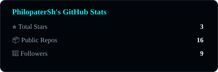
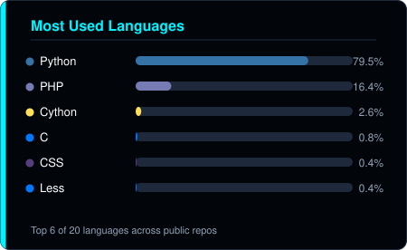

# Hi there, I'm Philopater Shenouda! 👋

**Penetration Tester Trainee @ Classera** — focused on web application and network security.
Backed by the Digilians cybersecurity diploma (MCIT × Egyptian Military Academy) and hands-on bug bounty work on HackerOne & Bugcrowd.

## 📜 Table of Contents

- [💼 Experience](#-experience)
- [🚀 Featured Project](#-featured-project)
- [📊 GitHub Stats](#-github-stats)
- [🧰 Skills & Tools](#-skills--tools)
- [📫 How to Reach Me](#-how-to-reach-me)
- [🙏 Support My Work](#-support-my-work)

## 💼 Experience

- **Penetration Tester Trainee @ Classera** — Oct 2026 - Present ● *current*
- **Cybersecurity Specialized Professional Diploma, First Batch @ Digilians** — MCIT × Egyptian Military Academy — Dec 2025 - Sep 2026
- **Bug Bounty Hunter @ HackerOne & Bugcrowd** — Aug 2025 - Dec 2025

> Full timeline, certifications, and writeups: **[philopatersh.github.io/Portfolio](https://philopatersh.github.io/Portfolio/)**

## 🚀 Featured Project

- [**Argus-Digilians**](https://github.com/PhilopaterSh/Argus-Digilians): An autonomous AI pentesting framework (Python + LangChain + local LLMs) that automates end-to-end reconnaissance and vulnerability assessment workflows in air-gapped environments. My Digilians graduation project.

## 📊 GitHub Stats

<table><tr>
<td width="50%"></td>
<td width="50%"></td>
</tr></table>

> Stats cards above are generated by this repo's own [`update-stats`](.github/workflows/update-stats.yml) workflow — self-hosted, no third-party rendering service to go down.

## 🧰 Skills & Tools

## 📫 How to Reach Me

Feel free to connect with me through the following platforms:

**Email**: [Philopater.Pentester@outlook.com](mailto:Philopater.Pentester@outlook.com)

## 🙏 Support My Work

If you find my work useful, please consider supporting me. It helps me to dedicate more time to open-source projects.

